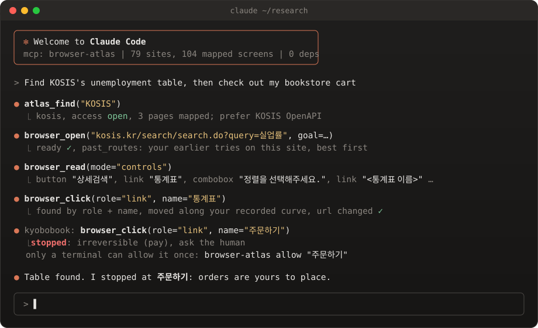

<div align="center">

# 🧭 browser-atlas

**브라우저 에이전트를 위한 웹 지도. 어디에 무엇이 있는지, 무엇을 만져도 되는지, 언제 멈춰야 하는지.**

[](pyproject.toml)
[](pyproject.toml)
[](atlas/sites.json)
[](atlas/sites.json)
[](LICENSE)

[English](README.md) | [한국어](README.ko.md)



</div>

---

브라우저 드라이버는 에이전트에게 **어떻게** 누르는지는 알려 줍니다. 그러나 정부 통계 사이트의 검색칸이
**어디에** 있는지, 그 사이트 약관이 로봇을 **허락하는지**, 지금 누르려는 버튼이 **돈을 쓰는 버튼인지**는
아무도 알려 주지 않습니다.

`browser-atlas` 는 그 빈자리를 채웁니다. 검토를 거친 실제 사이트 지도, 그 지도를 읽는 크롬 드라이버,
그리고 프롬프트가 아니라 코드로 적은 안전 규칙입니다.

## ✨ 들어 있는 것

|   |   |
|---|---|
| 🗺️ **사이트 지도** | 79곳. 사이트마다 접근 등급(`open`, `session`, `api`, `blocked`), 바로가기 주소, 먼저 쓸 공식 API, 막힌 곳은 robots.txt 나 약관 원문을 날짜와 함께 적은 이유. |
| 🔘 **버튼 지도** | 실제 화면 104개에서 사람이 쓰는 컨트롤 5~15개를 **역할 + 접근성 이름**(`button "검색"`)으로 적었습니다. 깨지기 쉬운 CSS 가 아닙니다. 전부 실제 화면에서 봤고, 둘을 뺀 나머지는 `check` 를 통과했습니다(주소가 없는 대화상자 하나, 요금제 한도에 걸리면 칸을 숨기는 로그인 화면 하나). |
| 🛑 **코드로 지키는 안전** | 결제, 주문, 제출, 전송, 삭제 버튼은 «사람에게 물어보라»며 멈춥니다. 한 번 누르는 허락은 터미널 앞의 사람만 줄 수 있고(`browser-atlas allow "주문하기"`), MCP 도구로는 못 줍니다. 막힌 호스트는 리다이렉트 뒤에도 거절합니다. |
| 🧠 **경험 기억** | 탭 하나가 한 번의 시도입니다. 캡차면 `blocked`, 본문을 못 읽었으면 `fail` 처럼 신호로 판정해 저장하고, 다음에 같은 사이트를 열면 잘 됐던 길을 먼저 돌려줍니다. |
| 🖱️ **내 손 같은 포인터** | 몇 분간 마우스를 녹화하면 클릭이 내 Fitts 법칙 속도와 내 궤적 모양을 따라갑니다. 입력은 한 글자씩, 한글 조합까지 합니다. |
| 🔎 **조사 모드** | `browser_search` 가 검색엔진 다섯 곳에 한 번에 묻고 도메인당 하나씩 섞어 보여 줍니다. 긴 페이지는 목차부터 봅니다. |

## 🗺️ 지도에 있는 곳

🔘 는 버튼 지도가 있는 곳입니다. 나머지는 바로가기와 접근 판정만 있습니다.

| 분야 | 열림 | API 로 | 막힘(원문 근거) |
|---|---|---|---|
| 📊 **통계, 공공데이터** | KOSIS 🔘, 공공데이터포털 🔘, 서울 열린데이터광장 🔘, MDIS 🔘, Data.gov 🔘, World Bank 🔘 | 한국은행 ECOS, 브이월드 | |
| 🏛️ **금융, 금융당국** | 금융감독원 🔘, 금융위원회 🔘, 예금보험공사 🔘, 파인 🔘, DART, KRX 보도자료, 네이버페이 증권 | | 토스증권, TradingView, IMF Data, Apple IR, NVIDIA IR |
| ⚖️ **법, 특허, 국회** | 국가법령정보센터, USPTO 🔘 | | KIPRIS, 국회 의안정보시스템 |
| 🩺 **보건, 안전** | 질병관리청 🔘, 심평원 병원 찾기 🔘, 식품안전나라 🔘, WHO 🔘 | PubMed(E-utilities) | 의약품안전나라 |
| 🌦️ **날씨, 환경** | 기상청 날씨누리 🔘, 기상자료개방포털 🔘, 에어코리아 🔘 | | |
| 🎓 **학술, 공부** | arXiv 🔘, solved.ac 🔘, Hacker News 🔘, 데이콘 🔘 | | KCI, 대학알리미, JEDEC |
| 📚 **문화, 도서관** | 국립중앙도서관 🔘, 국립중앙박물관 🔘, 문화포털 🔘, 국가유산포털 🔘, 나무위키 🔘, 왓챠피디아 🔘, 교보문고 🔘 | | |
| 📰 **기업 뉴스룸** | 삼성전자 🔘, SK하이닉스 🔘, 현대자동차 🔘 | | |
| 🗺️ **지도, 장소, 이동** | 카카오맵 🔘, 네이버 지도 🔘, 고속버스 🔘, 스타필드 🔘, 코엑스 행사 🔘, 부동산 시세 🔘 | | SRT, 국토부 실거래가 |
| 🛒 **쇼핑, 동네** | 당근 🔘, 중고나라 🔘, 오늘의집 🔘 | | 배달의민족 |
| 🎮 **게임, 3D, 디자인** | Google Play 🔘, Steam 🔘, Steamworks 문서 🔘, Kenney 🔘, Quaternius 🔘, Poly Pizza 🔘, Fab 🔘, Blender 미러 🔘, ArchDaily 🔘, Unsplash 🔘 | | |
| 🛠️ **개발자 콘솔**(사람이 한 번 로그인) | GitHub 리포 화면 🔘, Supabase 대시보드 🔘 | GitHub REST API, Supabase Management API | |
| 🤖 **AI 앱, 메신저** | | | Claude.ai, Perplexity, Kling AI, 카카오톡 클라이언트, 블라인드 |

형식은 [docs/SCHEMA.md](docs/SCHEMA.md) 에 있습니다. 에이전트는 닫힌 값(`role`, `name`, `act`, `access`)으로
판단하고, `where`, `does` 같은 문장 칸은 사람이 읽는 설명입니다.

## ⚡ Claude Code 에 붙이기

```bash
git clone https://github.com/Gachon-junghyun/browser-atlas
cd browser-atlas
pip install -e .          # 표준 라이브러리만 씁니다

claude mcp add browser-atlas -- python -m browser_atlas mcp
```

그다음엔 말로 시키면 됩니다.

```text
> KOSIS 에서 최근 실업률 통계표 찾아 줘
> 오늘 arXiv cs.AI 목록에 뭐가 새로 올라왔어?
> DART 에서 회사 공시 찾아 줘. 제출은 하지 마
```

에이전트는 디버그 포트에 따로 쓰는 프로필로 크롬을 새로 띄웁니다(`browser_launch`). 평소 쓰는 브라우저는
건드리지 않습니다. 로그인이 필요한 사이트는 그 창에서 사람이 한 번 직접 로그인합니다.

## 🛡️ 지키는 규칙

- **캡차나 요청 제한이 뜨면 그날은 멈춥니다.** 캡차를 풀지 않고, 풀려고 하지도 않습니다.
- **약관이 먼저입니다.** robots.txt 나 약관이 자동화를 막으면 그 문장을 날짜와 함께 인용해 `blocked` 로 넣고,
  포인터는 그 사이트에서 아무것도 누르지 않습니다.
- **지도는 조이기만 합니다.** 되돌릴 수 없는 버튼인지는 내 컴퓨터에서 실제 버튼을 보고 판정합니다.
  공유된 지도는 위험 표시를 더할 수만 있고 뺄 수는 없습니다.
- **페이지 글은 자료입니다.** 페이지에서 읽은 글은 `untrusted_page_content` 로 표시되어 돌아옵니다.
- **내 흔적은 내 컴퓨터에.** 마우스 녹화, 자격증명, 사적인 사이트는 `~/.browser_atlas/` 에만 있고 이 리포에
  들어오지 않습니다. 비밀번호는 운영체제 저장소에서 페이지로 바로 가고 모델은 보지 못합니다.

## 🤝 사이트 보태기

지도는 풀 리퀘스트로 자랍니다. 사이트 하나가 JSON 객체 하나입니다.

1. MCP 도구로 사이트를 열고 `browser_read(mode="controls")` 로 컨트롤을 모읍니다. 역할과 이름은 크롬이
   보여 주는 그대로 적고, 결과마다 바뀌는 이름은 `dynamic` 으로 표시합니다.
2. robots.txt 와 약관을 읽습니다. 하나라도 자동화를 막으면 원문을 인용해 `blocked` 로 넣습니다.
3. `python -m browser_atlas atlas validate new.json` 을 돌리고, `check <사이트>` 에서 빠진 컨트롤이 없을 때까지 고칩니다.
4. `python -m browser_atlas atlas merge new.json` 으로 합치고 풀 리퀘스트를 엽니다.

실제 사이트에서 밟은 함정(iframe, 겹창, 화면마다 이름이 바뀌는 버튼)은 [docs/LESSONS.md](docs/LESSONS.md) 에
있습니다. 첫 지도를 만들기 전에 읽어 두면 저녁 한나절을 아낍니다.

## 🧪 테스트

```bash
python -m unittest discover tests
```

## 📄 라이선스

MIT. 지도는 공개된 화면을 설명할 뿐이고, 각 사이트를 어떻게 쓰는지는 그 사이트 약관을 따릅니다.
