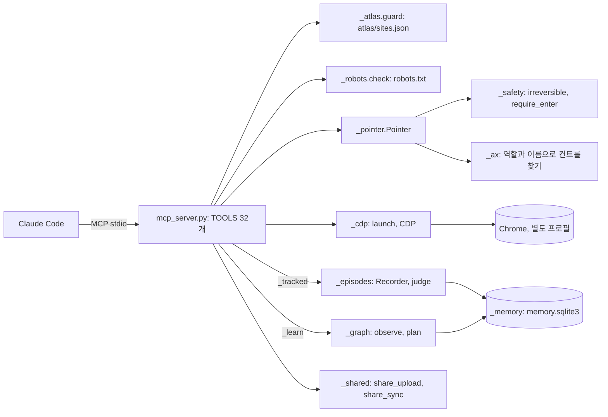
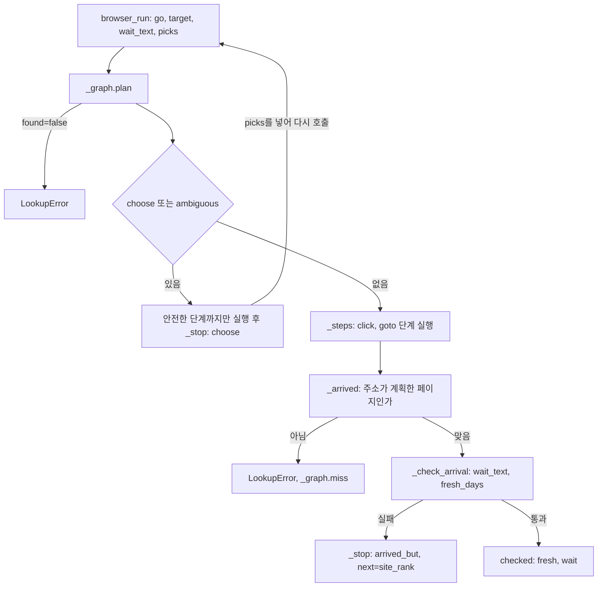

# browser-atlas

An MCP server that gives browser agents a reviewed atlas of 127 sites, a standard-library-only Chrome driver, an experience memory, and safety rules enforced in code (blocked sites, robots.txt, human-approved irreversible clicks).

English version and shared database setup: [README.en.md](README.en.md)

## 한 줄 소개

브라우저를 조종하는 AI 에이전트에게 "어느 사이트의 어느 화면에 무엇이 있는지, 거기서 해도 되는 일인지, 언제 멈춰야 하는지"를 알려 주는 사이트 지도와 크롬 조종기, 경험 메모리를 하나의 MCP 서버로 묶은 오픈소스이다.

## 무엇을 왜 만들었나

브라우저 자동화 도구는 에이전트에게 클릭하는 방법은 알려 주지만, 통계 사이트의 검색창이 어디에 있는지, 그 사이트의 약관이 로봇을 허용하는지, 지금 누르려는 버튼이 결제를 일으키는지는 알려 주지 않는다. 에이전트는 매번 같은 사이트에서 같은 곳을 헤매고, 안전 규칙은 프롬프트의 부탁으로만 존재한다. 이 프로젝트는 그 빈칸을 세 가지로 메우려고 만들었다.

1. 사람이 검토한 사이트 지도(`atlas/sites.json`). 사이트마다 접근 등급(`open`, `session`, `api`, `blocked`), 진입 주소, 우선할 공식 API, 막힌 사이트라면 그 이유를 담고, 일부 화면에는 버튼을 CSS 선택자가 아니라 역할과 접근성 이름(`button "검색"`)으로 적어 두었다.
2. 코드로 강제하는 안전 규칙. 결제, 주문, 제출, 전송, 삭제처럼 되돌릴 수 없는 컨트롤은 사람이 터미널에서 한 번 허락하기 전에는 도구가 거부한다. 막힌 사이트와 robots.txt가 금지한 주소도 거부한다.
3. 쓸수록 쌓이는 기억. 에이전트가 거친 경로, 실패, 함정을 서버가 스스로 기록하고 다음 방문에 되돌려 준다.

실행 환경은 사용자의 크롬이 아니라 별도 프로필로 띄운 크롬이고, 의존성은 파이썬 표준 라이브러리뿐이다(`pyproject.toml`의 `dependencies`가 비어 있다). 크롬과는 DevTools Protocol(CDP)로 직접 통신한다.

## 핵심 구조

MCP 서버(`mcp_server.py`)가 32개 도구를 노출하고, 모든 브라우저 호출은 지도 확인, robots.txt 확인, 안전 규칙을 거친 뒤 CDP로 크롬에 간다. 같은 호출은 `_tracked`가 에피소드로 기록하고 `_learn`이 로컬 페이지 그래프에 반영한다.



여러 번 거친 페이지는 `browser_run`의 `go` 단계로 한 번에 간다. `go`는 로컬 그래프에서 경로를 계획하고, 계획이 불확실하면 추측하지 않고 멈추며, 도착한 뒤에는 원하는 내용이 있는지와 날짜가 최근인지를 확인한다.



## 주요 기능

사이트 지도(`atlas/sites.json`, `docs/SCHEMA.md`). 127개 사이트가 들어 있다. 접근 등급은 `open` 90, `blocked` 27, `api` 7, `session` 3이다. 이 가운데 86개 사이트의 142개 화면에 버튼 지도(컨트롤 1,179개)가 있다. 에이전트가 판단에 쓰는 값은 `role`, `name`, `act`, `access` 같은 닫힌 값이고, `where`와 `does`는 사람이 읽는 설명이며 대부분 한국어이다. 지도에 있는 컨트롤은 실제 화면에서 역할과 이름으로 다시 찾아야 쓸 수 있어서, 지도 항목이 없는 버튼을 만들어 낼 수는 없다.

안전 규칙(`_safety.py`, `_robots.py`, `_atlas.py`).
- 되돌릴 수 없는 컨트롤의 판단은 사용자 컴퓨터에서 실제 컨트롤의 이름과 역할로 한다. 공유 지도는 위험 표시를 더할 수만 있고 뺄 수 없다.
- 검색창이 아닌 입력란에서 Enter를 누르는 것도 같은 규칙을 받는다. 장바구니 담기와 바로 구매는 멈추고, 장바구니 빼기는 멈추지 않는다.
- 허락은 `python -m browser_atlas allow "<컨트롤 이름>"`으로만 만들고 10분 안에 한 번만 쓸 수 있다. MCP 도구 목록에는 허락을 만드는 도구가 없다.
- 지도에 없는 사이트는 robots.txt가 판단한다. RFC 9309처럼 `*` 그룹에서 가장 긴 규칙이 이기고, 동률이면 Allow가 이긴다. 읽지 못한 파일은 허가가 아니라 "모름"으로 보고한다. 리다이렉트로 막힌 호스트에 도착한 경우에도 거부한다.
- 페이지에서 읽은 텍스트는 `untrusted_page_content`로 표시되어 돌아오고, 서버가 연 탭만 닫을 수 있다.

경험 메모리(`_episodes.py`, `_memory.py`). 탭 하나가 에피소드 하나이다. 탭을 닫거나 15분 동안 아무 일이 없거나 서버가 끝나면 신호로 판정해 저장한다. captcha나 접근 제한이 보이면 `blocked`, 내용을 한 번도 읽지 못했으면 `fail`, 오류로 끝났으면 `partial`, 그 밖에는 `success`이다. `browser_open(url, goal=...)`은 같은 사이트의 지난 경로(`past_routes`), 지도의 바로가기(`map_shortcuts`), 그 페이지에서 이미 겪은 함정(`map_traps`)을 돌려준다. 경로 순위는 목표 유사도, 경로 품질(베이지안, 사전값 0.5), 최근성(반감기 90일), 결과를 곱해 매기고, 한 자리는 덜 시도한 경로에 둔다.

로컬 페이지 그래프(`_graph.py`). 지도에 있든 없든 만난 모든 주소, 버튼, 링크를 이 컴퓨터의 SQLite에 쌓고, `browser_plan(target)`이 거기서 `browser_run` 단계를 만든다. 이 그래프는 공유 코드가 읽지 않는다.

연구용 읽기와 검색(`_search.py`, `browser_read`). `browser_search`는 다섯 검색 엔진(naver, google, bing, daum, duckduckgo)에 같은 질문을 던지고 엔진을 번갈아 가며 사이트당 결과 하나씩 섞어 돌려준다. 이미 많이 읽은 사이트는 표시한다. `browser_read`는 `outline`, `text`, `controls`, `links` 모드가 있고, 긴 글은 개요를 먼저 읽게 한다.

자기 마우스 학습(`_mouse.py`, `_keys.py`, `_pointer.py`). 사용자가 직접 마우스를 쓴 기록(Windows에서 ctypes로 커서와 왼쪽 버튼만 기록하고 키는 기록하지 않는다)으로 Fitts 법칙 `T = a + b * log2(1 + D/W)`의 계수와 경로 라이브러리를 맞추고, 클릭은 요소 안에서 `elementFromPoint`가 실제로 그 요소를 가리키는 지점에만 한다. 타이핑은 키 단위이며 한글 조합 과정을 재현한다. 기록이 없으면 최소 저크 곡선을 쓴다.

공유 데이터베이스(`_shared.py`, `server/schema.sql`). 기본은 모두 로컬이다. 사용자가 공유하겠다고 말한 경우에만 정제한 사본이 검토 대기열로 올라가고, 유지관리자가 병합한 행만 공개 테이블에 들어간다. 설정 파일이 없으면 아무것도 보내거나 받지 않는다.

MCP 도구 32개는 다음과 같이 묶인다.

| 묶음 | 도구 |
|---|---|
| 사이트 고르기와 기억 (8) | `site_rank`, `atlas_find`, `atlas_site`, `atlas_guard`, `memory_recall`, `memory_record`, `memory_rate`, `memory_stats` |
| 브라우저 조종 (16) | `browser_launch`, `browser_tabs`, `browser_open`, `browser_goto`, `browser_back`, `browser_run`, `browser_wait`, `browser_dismiss`, `browser_search`, `browser_read`, `browser_click`, `browser_type`, `browser_screenshot`, `browser_plan`, `browser_close`, `browser_close_mine` |
| 로컬 지도, 교훈, 공유 (6) | `map_local`, `lesson_record`, `map_learned`, `share_preview`, `share_upload`, `share_sync` |
| 로그인 확인 (2) | `login_sites`, `browser_login` |

## 실행 방법

설치와 MCP 등록. 이 세 명령은 검증 안 함.

```bash
git clone https://github.com/Gachon-junghyun/browser-atlas      # (검증 안 함)
cd browser-atlas
pip install -e .                                                 # (검증 안 함)
claude mcp add browser-atlas -- python -m browser_atlas mcp      # (검증 안 함)
```

저장소 루트에서 설치 없이 돌려 본 명령은 다음과 같다. 출력은 로컬 지도만 읽고 크롬이나 네트워크를 쓰지 않는다.

```bash
python -m browser_atlas --help                      # 명령 목록
python -m browser_atlas atlas validate              # 지도 검증 (오류 0, 경고 9건이 나온다)
python -m browser_atlas guard https://example.com   # 이 주소에서 자동화가 허용되는가
python -m browser_atlas rank "inflation tables"     # 지도와 지난 시도를 합친 사이트 순위
python -m unittest discover tests                   # 244개 테스트, 크롬과 네트워크 없이 통과
```

크롬이 필요한 명령은 아래와 같다. 모두 검증 안 함.

```bash
python -m browser_atlas launch --port 9222          # (검증 안 함) 별도 프로필의 크롬
python -m browser_atlas controls --tab example.com  # (검증 안 함) 화면의 역할과 이름
python -m browser_atlas check kosis                 # (검증 안 함) 지도의 컨트롤이 아직 있는가
python -m browser_atlas robots https://example.com/ # (검증 안 함) robots.txt 판정, 네트워크 사용
python -m browser_atlas mouse record --seconds 300  # (검증 안 함) Windows 전용
```

MCP로 연결하면 에이전트에게 "KOSIS에서 최근 실업률 표를 찾아 줘"처럼 말하는 것으로 충분하다. 에이전트는 `browser_launch`로 별도 프로필의 크롬을 띄우고, 로그인이 필요한 사이트는 사람이 그 창에서 한 번 직접 로그인한다. 사이트 하나를 지도에 더하는 방법은 `docs/SCHEMA.md`의 검증과 병합 절을 따른다(`atlas validate`, `atlas merge --dry-run`).

## 폴더 구조

```text
atlas/sites.json        검토된 사이트 지도 (127개)
browser_atlas/
  __main__.py           CLI 진입점
  mcp_server.py         MCP 서버, 도구 32개, browser_run 단계 실행
  _atlas.py             지도 읽기, 개인 덧씌우기, host로 사이트 찾기, guard
  _safety.py            되돌릴 수 없는 컨트롤 판정, 사람의 허락
  _robots.py            RFC 9309 방식 robots.txt 판정과 하루 캐시
  _cdp.py               표준 라이브러리만으로 만든 CDP 클라이언트, 크롬 실행
  _ax.py                접근성 트리에서 역할과 이름으로 찾기
  _pointer.py           클릭과 타이핑, 안전 규칙 적용
  _mouse.py, _keys.py   마우스 학습, 키 입력 계획(한글 조합 포함)
  _episodes.py          에피소드 기록과 판정, 지도 수리 제안
  _memory.py            경험 메모리와 순위
  _graph.py             로컬 페이지 그래프와 경로 계획
  _rank.py              site_rank 점수 계산
  _search.py            다섯 엔진 검색 결과 섞기
  _login.py             비밀번호가 모델을 거치지 않는 로그인 확인
  _shared.py            공유 데이터베이스 미리보기, 제출, 동기화
  _validate.py          오프라인 지도 검증과 병합
  _check.py             지도 건강 점검
docs/SCHEMA.md          지도 스키마와 신뢰 모델
docs/LESSONS.md         실제 사이트를 조종하며 얻은 현장 기록
server/schema.sql       공유 데이터베이스 테이블, 행 수준 보안, 병합 함수
tests/                  단위 테스트 17개 파일
```

## 배운 점과 한계

이력은 2026-10-26부터 27일까지 56개 커밋이다. 아래는 커밋 메시지, 코드 주석, `docs/LESSONS.md`, 테스트에 남은 시행착오이다. 결과를 숫자로 입증한 것은 별도로 적은 것뿐이다.

### 시행착오

1. 안전 규칙을 문서의 약속에서 코드로 옮겼다. 첫 버전은 지도 항목의 `irreversible` 필드를 정의하고 "에이전트는 이 앞에서 멈춘다"고 문서에만 적었으며, 멈추는 코드는 없었다(`8b42673`까지의 이력). 그러나 모든 사용자가 읽는 지도의 값에 위험 판단을 맡기면, 틀리게 쓰였거나 악의로 쓰인 항목이 곧바로 모든 에이전트의 판단이 된다. 그래서 `c08919f`에서 위험 여부를 실제 화면에서 읽은 이름과 역할로 사용자 컴퓨터에서 판정하고, 지도는 위험을 더할 수만 있게 했다(`_safety.irreversible`). 이후 에이전트 두 개로 14개 작업을 돌린 시험에서 장바구니 담기가 통과했고, 장바구니 빼기가 멈춰서 "담을 수는 있는데 되돌릴 수는 없는" 상태가 생겼다. 담기와 바로 구매를 목록에 넣고 빼기는 뺐다. 그 뒤에 `browser_run`의 `until` 자바스크립트 조건이 안전 규칙을 지나쳐 클릭할 수 있다는 점을 발견해 `wait_css`와 `wait_text`로 바꿨다. 남은 한계는 판정이 단어 목록(한국어 24개, 영어 21개)이라 목록에 없는 표현의 위험한 버튼은 막지 못한다는 점이다.

2. 페이지 키를 경로만으로 잡았다가 경로와 쿼리로 바꿨다. 로컬 그래프의 첫 버전은 페이지를 경로로만 구분했는데, 게시판 번호가 쿼리(`?id=7`, `?id=8`)에 있는 사이트에서 모든 게시판이 한 페이지로 합쳐져 엉뚱한 게시판으로 가는 계획이 나왔다. `_graph.path_of`는 이제 경로에 "어느 페이지인지를 말해 주는 쿼리 값"을 붙이고, 검색어와 세션 값과 24자를 넘는 값은 뺀다. 이어진 수정에서 사물(종목 코드 등)이 쿼리에 있는 경우도 다뤘다. 남은 한계는 어떤 쿼리 키가 신원이고 어떤 키가 잡음인지를 정규식 목록(`_NOT_IDENTITY`)으로 사람이 정했다는 점이라, 처음 보는 사이트에서는 틀릴 수 있다.

3. 모를 때 추측하던 `go`가 물어보도록 바뀌었다. 로컬 그래프로 가는 `go`의 첫 버전은 "on"이라는 단어를 종목 ON으로 읽는 식으로 일곱 곳에서 추측했다. 검토에서 이를 찾아 선택 지점(어느 종목인지, 어느 토글인지)에서는 안전한 단계까지만 실행하고 `choose`를 돌려주며, 에이전트가 `picks`로 답하면 이어 가도록 바꿨다. 도착한 뒤에도 주소가 맞다고 끝내지 않는다. 빈 프레임이나 1년 전 목록도 맞는 주소에서 답처럼 읽히기 때문에, `wait_text`가 없거나 날짜 목록이 `fresh_days`보다 오래되면 `arrived_but`로 실패시키고 다른 사이트를 찾도록 `site_rank`를 가리킨다. 이 다듬기가 "loop r1"부터 "r10"까지 이름이 붙은 커밋 아홉 개로 이어졌고, 각 수정마다 `tests/test_go.py`에 테스트가 붙었다. 남은 한계는 날짜 읽기가 정규식과 휴리스틱(한국어와 영어 표기, "N시간 전", 연도 없는 월.일)이라는 점이며, 정확도는 측정하지 않았다.

4. 에이전트가 만든 도구를 쓰지 않았다. 지도를 준 헤드리스 에이전트가 `goto`와 `read`를 44번 부르고 `go`는 한 번도 부르지 않았으며, 스스로 넣은 sleep 단계에 46초를 썼다. 지도 없는 같은 에이전트보다 느리고 비쌌다(커밋 `8098d5f`의 기록). 서버 지침 문구를 "아는 페이지는 go로, 단계는 한 호출에 모아서, 읽을 때는 find나 outline으로, sleep은 직접 넣지 말 것"으로 고쳤다. 이 수정 뒤에 같은 조건으로 다시 잰 기록은 이력에 없다. 도구의 기능이 아니라 지침 문구가 사용량을 바꾼다는 가설은 아직 검증하지 않았다.

5. 경험 판정의 오탐을 고쳤다. 첫 판정기는 읽은 텍스트 어디에든 "rate limit"이나 "captcha"가 있으면 `blocked`로 처리했다. 그 결과 약관과 API 정책 페이지(PyPI, crates.io, Hugging Face 등)를 읽은 정상 방문이 차단으로 기록됐다. 이제 제목, 컨트롤 목록 안의 captcha 위젯, 본문 맨 앞의 안내 문구, 또는 안내문밖에 못 될 만큼 짧은 페이지에서만 차단으로 본다(`_episodes.looks_blocked`). 별개로, 기다리던 문구가 끝내 안 나오면 예외가 나서 에피소드가 시작도 되지 않아 방문 기록이 통째로 사라지는 문제도 있었다. 이제 `browser_open`은 시간이 지나도 페이지를 돌려주고 대기 실패를 단계로 남기며, 기록 없이 서버가 연 탭에서 일어난 단계는 그 탭에서 에피소드를 새로 시작한다. 남은 한계는 판정 점수와 순위 가중치(사전값 0.5, 반감기 90일 등)가 손으로 정한 값이고 실제 데이터로 맞춘 적이 없다는 점이다.

6. 지도에 없는 사이트에는 robots.txt를 직접 구현했다. 지도에 없는 호스트에는 아무 판정이 없어 robots.txt와 상관없이 열렸다. 파이썬 표준 `urllib.robotparser`는 첫 번째로 맞는 규칙을 쓰기 때문에 Allow와 Disallow가 섞인 파일에서 틀리므로, 가장 긴 규칙 우선과 동률 시 Allow 우선인 RFC 9309 방식 판정기를 따로 만들었다(`_robots.py`, `tests/test_robots.py`). 읽을 수 없는 파일은 허가로 취급하지 않고 "모름"으로 알린다. 거부된 시도도 경험 행으로 남겨 다음 시도가 배우게 했다. 남은 한계는 `*` 그룹만 보며 크롤 지연과 사이트맵 같은 지시어는 다루지 않는다는 점이다.

7. 공유를 직접 쓰기에서 검토 대기열로 바꿨다. 첫 공유 설계는 유지관리자만 쓰는 공개 테이블이었는데, 이후 누구나 계정 없이 대기열에 제출하고 유지관리자가 병합한 행만 공개되는 구조로 바꿨다(`server/schema.sql`의 `submissions`와 병합 함수, 분당 120건과 대기 5,000건 제한). 지도 수리 제안은 두 번 관찰되어야 공유되고(`tests/test_shared.py`), 로그인 레시피가 있는 계정의 호스트와 개인 사이트는 올라가지 않는다. 대기열의 글은 낯선 사람이 쓴 텍스트이므로 사람이 데이터로만 읽는다. 남은 한계는 이 서버 쪽 규칙이 SQL로만 존재하고 이를 검증하는 테스트가 없다는 점(`tests/`에서 `schema.sql`을 쓰는 곳이 없다)과, 병합이 유지관리자의 수작업에 달려 있다는 점이다.

8. 로그인 자동화를 포기하고 "세션 확인"으로 줄였다. 약 40개 사이트를 조사했더니 자동 로그인이 현실적인 곳은 4곳이었고 나머지는 captcha, 기기 인증, 매직 링크, QR에 막혔다(`docs/LESSONS.md`). 그래서 `_login.py`는 사람이 한 번 로그인한 세션이 살아 있는지만 확인하고, 죽었다면 로그인 창을 열어 주고 멈춘다. 자동 로그인이 가능한 사이트에서도 비밀번호는 모델이 보는 반환값에 나오지 않고 페이지에 바로 입력된다. 남은 한계는 자격 증명 저장이 Windows에서만 DPAPI로 암호화되고 다른 운영체제에서는 권한 600의 평문 파일이라는 점이다(`_login.set_credential`).

9. 사소해 보이는 입력과 화면 문제가 가장 오래 걸렸다. 창이 다른 창에 완전히 가려지면 Windows 크롬이 탭을 숨김 상태로 만들어 React 팝업이 열리지 않았고, 클릭은 도착하는데 아무 일도 일어나지 않았다. 크롬 실행 옵션에 가림 감지를 끄는 플래그를 넣었다(`_cdp.launch`). 자동완성 입력란(GitHub 토픽)에서 마지막 글자가 빠지는 문제는 접두어를 입력하고 제안이 뜨기를 기다린 뒤 마지막 글자를 입력하도록 바꿔 고쳤다(`browser-automation`이 `browser-automatio`로 저장되던 사례). 이런 현상은 `docs/LESSONS.md`에 "측정부터 하라"(줌, `visibilityState`, `elementFromPoint`)라는 순서로 정리해 두었다.

### 개발 환경에 대해 한 일

- 크롬 없이 도는 테스트 244개. `tests/test_go.py`의 가짜 브라우저(`_Browser`)가 주소별 페이지 텍스트와 클릭으로 인한 이동, 새 탭, 지연된 리다이렉트를 흉내 낸다. 덕분에 `go`의 수정이 실제 사이트 없이 몇 초 단위로 반복되었다. 전체 실행은 30초 남짓이다(Windows, Python 3.11 한 곳에서만 확인).
- 에이전트로 쓴 결함 찾기. 결함을 찾으면 `tests/test_regressions.py`에 한 건당 테스트 하나를 붙이는 규칙으로 진행했다(`Wave1`). 커밋 메시지에 AI 모델의 공동 작성자 표기가 있듯 개발 자체도 AI 모델과 함께 했다.
- 지도 검증기. `atlas validate`는 중복 키, 닫힌 역할 목록, 안정적이지 않은 CSS(해시된 클래스 이름), 개인 흔적(로컬 경로, 이메일, 전화번호, 토큰 모양 문자열)을 오프라인으로 검사한다. 공유 지도에 개인 정보가 섞이는 사고를 병합 전에 막으려는 장치이다.

### 한계

- Windows에서만 확인했다. 마우스 기록기는 Windows 전용이고(`_mouse.py`가 다른 운영체제에서는 예외를 낸다), 가림 감지 플래그도 Windows 크롬 문제를 겨냥한다. macOS와 Linux에서는 크롬 경로 탐색 코드만 있고 실행해 보지 않았다.
- 지도는 사람이 만들어서 낡는다. `check`는 실제 크롬이 있어야 돌고, 사이트가 화면을 바꾸면 컨트롤이 사라진다. 현재 `atlas validate`에도 경고 9건(변하는 이름 표시 누락, 중복 컨트롤 이름 등)이 남아 있다.
- CI 설정이 없다. 테스트는 로컬에서만 돈다.
- 공유 데이터베이스는 외부 서버가 있어야 하며, 테스트는 모의 응답으로만 검증한다. 병합이 유지관리자의 수작업이라 제출이 많아지면 병목이 된다.
- 판정, 순위, 날짜 읽기, 위험 단어 목록은 규칙과 손으로 정한 가중치이다. 정확도나 성능 수치는 측정한 적이 없어서 적지 않는다.
- 지도의 `where`와 `does` 설명은 대부분 한국어라 영어 사용자는 닫힌 값(`role`, `name`, `act`)에 의존해야 한다.
- 지도는 공개 페이지를 설명할 뿐이다. 각 사이트의 약관은 사용하는 사람이 따로 지켜야 한다.

## 라이선스

MIT 라이선스이다(`LICENSE` 파일).
